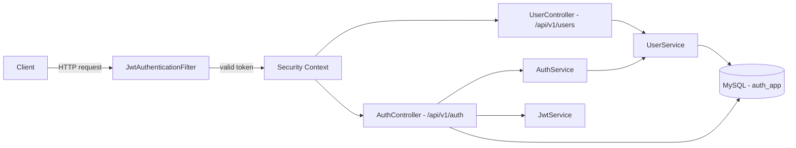
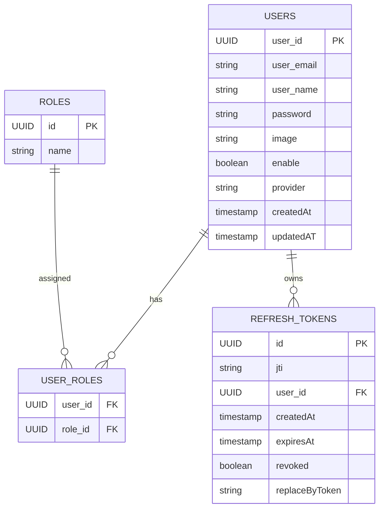
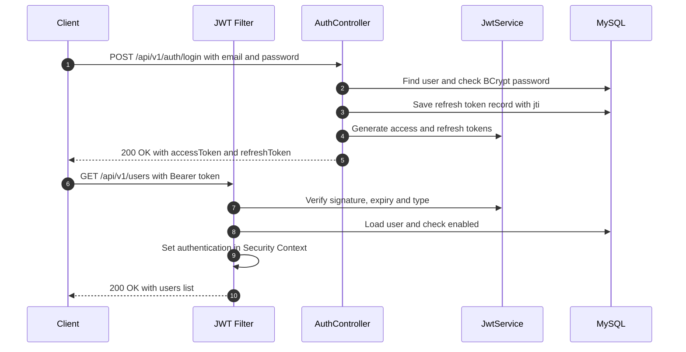

<div align="center">

# 🔐 Auth Application

### Secure JWT Authentication API with Spring Security

*Stateless login, signed access and refresh tokens, BCrypt passwords, and protected user management.*

<br/>


<br/>

[✨ Features](#-features) •
[🏗️ Architecture](#️-architecture) •
[🚀 Quick Start](#-quick-start) •
[📡 API](#-api-reference) •
[🧠 How It Works](#-how-it-works) •
[🗺️ Roadmap](#️-roadmap)

</div>

---

## 💡 About

**Auth Application** is a backend REST API that handles user **registration**, **login**, and **JWT-based authentication** using Spring Boot and Spring Security. After logging in, a user receives a signed **access token** and a **refresh token**. Every protected request is checked by a custom JWT filter. The server keeps no sessions, so it is fully **stateless** and easy to scale.

---

## ✨ Features

<table>
<tr>
<td width="50%" valign="top">

### 🔑 JWT Authentication
- **Access token**: valid for 1 hour (configurable)
- **Refresh token**: valid for 24 hours (configurable)
- Signed with **HMAC-SHA512**
- Tokens carry `email`, `roles` and a token type (`typ`)

</td>
<td width="50%" valign="top">

### 🛡️ Spring Security
- Custom **`JwtAuthenticationFilter`** on every request
- **Stateless** sessions (no server-side session)
- Passwords hashed with **BCrypt**
- Disabled users are blocked from logging in

</td>
</tr>
<tr>
<td width="50%" valign="top">

### 👤 User Management
- Full **CRUD** for users
- Look up a user by **ID** or **email**
- **UUID** primary keys
- Support for **roles** and **providers** (LOCAL, GOOGLE, GITHUB, FACEBOOK)

</td>
<td width="50%" valign="top">

### ⚠️ Clean Error Handling
- Global `@RestControllerAdvice`
- Consistent JSON errors: status, message, path, timestamp
- Clear messages for **expired** and **invalid** tokens
- `401`, `400` and `404` responses

</td>
</tr>
</table>

---

## 🛠️ Tech Stack

| Layer | Technology |
|---|---|
| ☕ Language | Java 22 |
| 🌱 Framework | Spring Boot 4.0.2 (Web, Data JPA, Validation) |
| 🛡️ Security | Spring Security + JJWT 0.12.3 |
| 🐬 Database | MySQL |
| 🔁 Mapping | ModelMapper |
| 🧰 Utilities | Lombok |
| 📦 Build | Maven (wrapper included) |

---

## 🏗️ Architecture



### 📁 Project Structure

```
src/main/java/com/example/auth/
├── 🚀 AuthApplication.java
├── ⚙️ config/
│   ├── SecurityConfig.java          # Filter chain, BCrypt, AuthenticationManager
│   └── ProjectConfig.java           # ModelMapper bean
├── 🛡️ Security/
│   ├── JwtService.java              # Create and parse JWTs
│   ├── JwtAuthenticationFilter.java # Validates Bearer token on each request
│   └── CustomUserDetailService.java # Loads a user by email
├── 🌐 controllers/
│   ├── AuthController.java          # /register, /login
│   └── UserController.java          # User CRUD
├── 🧩 services/                     # AuthService, UserService + implementations
├── 📦 entities/                     # User, Role, RefreshToken, Provider
├── 📨 dtos/                         # UserDto, LoginRequest, TokenResponse, ApiError...
├── 🗄️ repositories/                 # UserRepo, RefreshTokenRepo
├── ⚠️ exceptions/                   # GlobalExceptionHandler, ResouceNotFoundException
└── 🧰 helpers/UserHelper.java       # UUID parsing
```

### 🗃️ Data Model



---

## 🚀 Quick Start

### 1️⃣ Prerequisites

- ☕ JDK **22+**
- 🐬 MySQL running on `localhost:3306`

Start MySQL with Docker:

```bash
docker run -d --name auth-mysql -p 3306:3306 \
  -e MYSQL_ROOT_PASSWORD=yourpassword -e MYSQL_DATABASE=auth_app \
  mysql:8
```

### 2️⃣ Clone the repo

```bash
git clone https://github.com/Negi100/Auth_Application.git
cd Auth_Application
```

### 3️⃣ Configure

Edit `src/main/resources/application.properties`, or set these environment variables:

| Property | Env variable | Default |
|---|---|---|
| `spring.datasource.url` | `SPRING_DATASOURCE_URL` | `jdbc:mysql://localhost:3306/auth_app` |
| `spring.datasource.username` | `SPRING_DATASOURCE_USERNAME` | `root` |
| `spring.datasource.password` | `SPRING_DATASOURCE_PASSWORD` | *(your password)* |
| `security.jwt.secret` | `JWT_SECRET` | ⚠️ **at least 64 characters** |
| `security.jwt.issuer` | `JWT_ISSUER` | `api.substring.com` |
| `security.jwt.access-ttl-seconds` | `JWT_ACCESS_TTL_SECONDS` | `3600` (1 hour) |
| `security.jwt.refresh-ttl-seconds` | `JWT_REFRESH_TTL_SECONDS` | `86400` (24 hours) |

> ⚠️ The app **won't start** if the JWT secret is shorter than 64 characters. Generate one with:
> ```bash
> openssl rand -base64 64
> ```

### 4️⃣ Run

```bash
./mvnw spring-boot:run        # Windows: mvnw.cmd spring-boot:run
```

🎉 The API is now running at **`http://localhost:8080`**

---

## 📡 API Reference

### 🔓 Public endpoints (no token needed)

| Method | Endpoint | Description | ✅ Success | ❌ Error |
|:---:|---|---|:---:|:---:|
|  | `/api/v1/auth/register` | Register a new user | `201` | `400` |
|  | `/api/v1/auth/login` | Log in and receive tokens | `200` | `400` |

### 🔒 Protected endpoints (`Authorization: Bearer <accessToken>`)

| Method | Endpoint | Description |
|:---:|---|---|
|  | `/api/v1/users` | Get all users |
|  | `/api/v1/users/{userId}` | Get a user by ID |
|  | `/api/v1/users/email/{email}` | Get a user by email |
|  | `/api/v1/users` | Create a user |
|  | `/api/v1/users/{userId}` | Update a user |
|  | `/api/v1/users/{userId}` | Delete a user |

<details>
<summary><b>📝 Register</b></summary>

```bash
curl -X POST http://localhost:8080/api/v1/auth/register \
  -H "Content-Type: application/json" \
  -d '{"email": "negi@example.com", "name": "Negi", "password": "secret123"}'
```

</details>

<details>
<summary><b>🔑 Login</b></summary>

```bash
curl -X POST http://localhost:8080/api/v1/auth/login \
  -H "Content-Type: application/json" \
  -d '{"email": "negi@example.com", "password": "secret123"}'
```

**Response:**

```json
{
  "accessToken": "eyJhbGciOiJIUzUxMiJ9...",
  "refreshToken": "eyJhbGciOiJIUzUxMiJ9...",
  "expiresIn": 3600,
  "tokenType": "Bearer",
  "user": { "id": "a1b2c3d4-...", "email": "negi@example.com", "name": "Negi" }
}
```

</details>

<details>
<summary><b>👥 Call a protected endpoint</b></summary>

```bash
curl http://localhost:8080/api/v1/users \
  -H "Authorization: Bearer <accessToken>"
```

Without a valid token, the API returns:

```json
{
  "Status": 401,
  "error": "Unauthorized Access",
  "message": "Token Expired",
  "path": "/api/v1/users"
}
```

</details>

---

## 🧠 How It Works



### 🎫 What's inside the tokens

| Claim | Access token | Refresh token |
|---|:---:|:---:|
| `jti` (unique ID) | ✅ | ✅ (also saved in the database) |
| `sub` (user ID) | ✅ | ✅ |
| `iss`, `iat`, `exp` | ✅ | ✅ |
| `email` | ✅ | — |
| `roles` | ✅ | — |
| `typ` | `access` | `refresh` |

> ⚡ **Why store the refresh token's `jti`?** It lets the server **revoke** a refresh token (log out, or rotate tokens) even though JWTs are stateless.

---

## 🗺️ Roadmap

- [ ] 🔄 `/api/v1/auth/refresh` endpoint to swap a refresh token for a new access token
- [ ] 🍪 Send the refresh token in an **HttpOnly cookie** (the config options already exist)
- [ ] 🚪 Logout endpoint that revokes refresh tokens
- [ ] 🏷️ Assign a default role (e.g. `ROLE_USER`) at registration
- [ ] 👮 Role-based access control (`@PreAuthorize`) for admin-only endpoints
- [ ] 🔒 Hash passwords on user update, and hide `password` in API responses
- [ ] ✅ Request validation (`@Valid`, `@Email`, password rules)
- [ ] 🌐 OAuth2 login with Google and GitHub (the `Provider` enum is ready)
- [ ] 📖 Swagger / OpenAPI documentation
- [ ] 🐳 `docker-compose.yml` for one-command setup

---

## 🤝 Contributing

Contributions are welcome!

1. 🍴 Fork the repo
2. 🌿 Create a branch: `git checkout -b feature/amazing-feature`
3. 💾 Commit: `git commit -m "Add amazing feature"`
4. 🚀 Push and open a **Pull Request**

---

<div align="center">

### ⭐ If you found this project helpful, give it a star!

Made with ☕ and 🌱 Spring Boot by [**Negi100**](https://github.com/Negi100)

</div>
